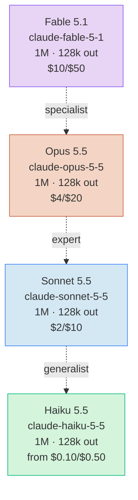

# 模型概览

> **TL;DR**：Claude 当前活跃 4 条产品线——**Fable 5.1**（高难推理与长程 agent）/ **Opus 5.5**（长跑 agentic 编码与知识工作）/ **Sonnet 5.5**（速度与智能的最佳平衡）/ **Haiku 5.5**（高并发、延迟敏感的分类/提取/路由）。本页是 API/SDK 视角的全貌与多维度选型指南。

⏱ 预计阅读时间：8 分钟

## 你能在这里学到

- 4 条产品线在 API 层的 Model ID、定价、context window、默认 effort
- 每个模型支持的**能力组合**（adaptive thinking / prompt caching / batch / tool use / vision）
- **官方定位原文**（specialist / expert / generalist / fastest-near-frontier）
- **多维度选型决策**（任务 / 成本 / 延迟 / 数据驻留 / 规模）
- Legacy 模型的快速索引与不再推荐的原因

## 一、家族谱系



> CLI 视角的 `/model` / `/effort` 与 provider 差异表见 [Claude Code · 模型选择](/claude-code/basics/model-selection)。

## 二、当前活跃 4 条产品线（API 视角速查）

数据来自 [Anthropic Docs · Models overview](https://platform.claude.com/docs/en/about-claude/models/overview)（访问于 2026-10-08）。

| 模型 | Model ID | Context | Max output | 思考 | 默认 effort | Pricing（输入/输出 $ / 1M tok） | 何时用 |
| --- | --- | --- | --- | --- | --- | --- | --- |
| **Fable 5.1** | `claude-fable-5-1` | 1M | 128k | Adaptive（**总是开**） | `high` | **$10 / $50** | 高难推理、长程 agent；Opus 5.5 提高 effort 后仍不够时 |
| **Opus 5.5** | `claude-opus-5-5` | 1M | 128k | Adaptive（**总是开**） | `medium` | $4 / $20 | 长跑 agentic 编码与知识工作；**多数负载的默认起点** |
| **Sonnet 5.5** | `claude-sonnet-5-5` | 1M | 128k | Adaptive | `high` | $2 / $10 | 速度与智能的最佳组合；日常主力 |
| **Haiku 5.5** | `claude-haiku-5-5` | 1M | 128k | Adaptive | `medium` | **from $0.10 / $0.50** | 高并发、延迟敏感：分类、提取、路由、subagent |

**官方定位原文**（同一页 Description 行）：

| 模型 | Description |
| --- | --- |
| Fable 5.1 | For demanding reasoning and long-horizon agentic work |
| Opus 5.5 | For long-running agentic coding and knowledge work |
| Sonnet 5.5 | The best combination of speed and intelligence |
| Haiku 5.5 | For high-volume, latency-sensitive tasks such as classification, extraction, and routing |

> ⚠️ **Haiku 5.5 是唯一按 prompt 长度分档计费的型号**：prompt ≤ 100k token 时 $0.10 / $0.50，> 100k 时跳到 $0.50 / $2.50。它是 1M 上下文，但**不在**「长上下文按标准价计费」的豁免名单里（唯一豁免的就是它自己）。缓存读分别为 $0.01 与 $0.05。

> ⚠️ **迁移风险**：`thinking: {"type": "disabled"}` 与 `{"type": "enabled", ...}` 在 **Opus 5.5 / Fable 5.1** 上一律返回 400——只能省略 `thinking` 字段、改用 `effort`。**Sonnet 5.5 是例外**：它接受 `thinking: {"type": "between_tools"}` 关掉前置思考，但仅限 `high` 及以下 effort。`tool_choice` 的 `any` / `tool` 在三者上都返回 400。

**调用方式**（以 Python SDK 为例）：

```python
import anthropic
client = anthropic.Anthropic()

# 任选其一
msg = client.messages.create(
    model="claude-sonnet-5-5",        # 或 claude-opus-5-5 / claude-fable-5-1 / claude-haiku-5-5
    max_tokens=1024,
    messages=[{"role": "user", "content": "..."}],
)
```

## 三、官方比喻式定位

来自 [Anthropic Blog · Choosing a Claude model and effort level in Claude Code](https://claude.com/blog/claude-model-and-effort-level-in-claude-code)（原文发布于 2026-07-07）：

- **Fable = the specialist**——见过几乎没人见过的问题的顶级专家；长链条、多步骤工作中优势最大
- **Opus = the expert**——领域专家；在陌生代码里靠模式识别就能帮你
- **Sonnet = a really good generalist**——优秀通才；给足上下文能透彻理解你的具体代码
- **Haiku** = the fastest near-frontier——主打"最快接近前沿"

> ⚠️ 截至 2026-10-08 未从可访问的官方源复核上述比喻原文——该页正文为前端渲染，本轮只取到页面元信息。上面四条比喻沿用仓库既有记录，**读的时候以第二节的官方 Description 原文为准**。

## 四、API 能力矩阵（哪些模型支持什么）

| 能力 | Fable 5.1 | Opus 5.5 | Sonnet 5.5 | Haiku 5.5 |
| --- | :---: | :---: | :---: | :---: |
| **Adaptive thinking** | ✅ 总是开 | ✅ 总是开 | ✅ | ✅ |
| **Extended thinking（`budget_tokens`）** | ❌ | ❌ | ❌ | ❌ |
| **Prompt Caching** | ✅ | ✅ | ✅ | ✅ |
| **Message Batches API** | ✅ | ✅ | ✅ | ✅ |
| **Tool use** | ✅ | ✅ | ✅ | ✅ |
| **Vision（图片输入）** | ✅ | ✅ | ✅ | ✅ |
| **1M context** | ✅ | ✅ | ✅ | ✅（>100k prompt 加价） |
| **Batch 输出至 300k（beta）** | — | ✅ | ✅ | ✅ |
| **Zero data retention** | ❌ 强制 30 天留存 | ✅ | ✅ | ✅ |

> **Extended thinking 一行值得展开**：官方口径是 legacy `thinking.type: "enabled"` + `budget_tokens` 在 Claude Opus 4.6 / Sonnet 4.6 上**已废弃**，在**更晚的模型上一律不接受**——Haiku 5.5 换代的 breaking change 正是这一条（Haiku 4.5 的代码直接搬过去会 400）。
>
> **Batch 300k 输出一行为空是有原因的**：官方点名支持该 beta 的模型是 Opus 5.5 / Opus 5 / Sonnet 5.5 / Sonnet 5 / Haiku 5.5 / Opus 4.8 / 4.7 / 4.6 / Sonnet 4.6，**Fable 5.1 不在其中**。

> 详细 API 字段与请求结构见 v0.3.2 段的 API 9 篇（[Messages API](/claude-capabilities/api/messages) 等）。

## 五、选型决策指南

选型不是"哪个模型最聪明"，而是**多约束下的最优解**——任务类型、成本预算、延迟要求、数据驻留、规模五个维度。

```
                ┌─ 任务类型 ──────── 短对话 / 编程 / 长链 agent / 批量 / 视觉
                │
                ├─ 成本预算 ──────── 个人 $50/月 / 团队 $500/月 / 企业自定
                │
选型决策 ───────┼─ 延迟要求 ──────── < 200ms / < 2s / < 30s / 24h batch
                │
                ├─ 数据驻留 ──────── 普通 / ZDR（Zero data retention）
                │
                └─ 规模 ────────── PoC / 生产小流量 / 生产大流量 / 企业内网
```

### 按任务类型——直接抄的决策表

| 任务类型 | 首选 | 次选 | 不推荐 |
|---------|------|------|--------|
| 短对话（< 5 步） | Sonnet 5.5 | Haiku 5.5 | Opus 5.5、Fable 5.1（杀鸡用牛刀） |
| 日常编程（80% 场景） | **Sonnet 5.5** | Opus 5.5 | Fable 5.1 |
| 复杂编程（陌生代码 / 重构） | Opus 5.5 | Sonnet 5.5 + 多轮迭代 | Haiku 5.5 |
| 长链 agent（10+ 步） | Opus 5.5 | Sonnet 5.5 | Haiku 5.5 |
| 超长链 agent（30+ 步） | **Fable 5.1** | Opus 5.5（提高 effort 后仍不够再上 Fable） | Sonnet 5.5、Haiku 5.5 |
| 批量任务（> 1 万条） | Haiku 5.5 + Batch API | Haiku 5.5 online | Opus 5.5 / Fable 5.1（贵） |
| 分类 / 提取 / 格式化 / 路由 | Haiku 5.5 | Sonnet 5.5 | Opus 5.5、Fable 5.1 |
| Vision（图 / PDF） | Sonnet 5.5 | Opus 5.5 | — |
| 实时语音 / 视频流 | Haiku 5.5 streaming | Sonnet 5.5 | Opus 5.5、Fable 5.1（延迟） |

### 按成本预算——月度 token 估算

**个人开发者**（$50/月）：

```
日常 80% 任务用 Sonnet 5.5 → ~$5/月
+ 偶尔 Opus 5.5 处理大任务 → ~$4/月
= 总 ~$9/月，离 $50 预算很远
```

**小团队**（5-10 人，$500/月）：

```
每人每天 20 万输入 + 5 万输出 × 5 人 × 30 天
= 按 Sonnet 5.5 ≈ $150/月 + 偶尔 Opus 5.5 ≈ $80
= 总 ~$230/月，预算内
```

**生产大流量**（日均 100 万请求）：

```
60% Haiku 5.5 + 30% Sonnet 5.5 + 10% Opus 5.5
+ Prompt Caching → + Batch API
→ 相比全用上一代型号可再省一大截（Haiku 5.5 输入价是 Haiku 4.5 的 1/10）
```

> ⚠️ 上面三段是**量级示意**，不是精确测算——官方未公布典型请求的 token 分布，且 Haiku 5.5 的价格随 prompt 是否超过 100k token 跳档。真实预算请用自己 1000 条真实请求的 token 统计代入官方价目表算。

### 按延迟要求

官方只给**相对延迟档**（Comparative latency），不给绝对毫秒数：

| 延迟档 | 推荐 |
|--------|------|
| **Fastest** | Haiku 5.5 |
| **Fast** | Sonnet 5.5 |
| **Moderate** | Opus 5.5 |
| **Slower** | Fable 5.1 |

实际延迟取决于 prompt 长度、输出长度与 thinking effort。

### 按数据驻留（ZDR）

| 模型 | ZDR 支持 |
|------|---------|
| Opus 5.5 | ✅ |
| Sonnet 5.5 | ✅ |
| Haiku 5.5 | ✅ |
| **Fable 5.1** | ❌ 强制 30 天数据留存 |

Fable 5 / Fable 5.1 / Mythos 5 / Mythos 5.1 都要求 30 天数据留存，ZDR 环境下不可用（除非 Anthropic 特别授权）——需要长链 agent 能力时 fallback 到 Opus 5.5。

### 按规模

| 阶段 | 策略 |
|------|------|
| **PoC** | 单一 Sonnet 5.5，别过早优化 |
| **小流量生产**（< 1 万/天） | Sonnet 5.5 + Opus 5.5 混搭，Prompt Caching 30%+ |
| **大流量生产**（> 10 万/天） | 三层分流（Haiku 5.5 / Sonnet 5.5 / Opus 5.5）+ Batch API + 跨 region |
| **企业内网** | 显式 pin Model ID + ZDR 必开 |

### 完整决策树

```
任务是什么？
  │
  ├─ 批量 / 分类 / 提取 / 路由 ── Haiku 5.5 + Batch API
  │
  ├─ 短对话 / 文档 / 80% 编程 ─── Sonnet 5.5（默认）
  │
  ├─ 复杂编程 / 陌生代码 ──────── Opus 5.5
  │
  └─ 长链多步 agent ────────────── Opus 5.5 起步
                                    │
                                    ├─ 提 effort 仍不够 ── Fable 5.1
                                    │
                                    ├─ ZDR？────────────── 改 Opus 5.5（Fable 不支持）
                                    │
                                    └─ prompt > 100k？───── 重算预算（Haiku 跳档）
```

**反直觉**：用 Sonnet 反复迭代可能比 Opus 少步数直接搞定更贵——大模型少步数总成本可能更低。详细成本计算见 [成本与 Token 管理](/claude-code/basics/cost-and-tokens)。

## 六、Legacy 模型索引

以下型号**仍可调用**，但不推荐用于新项目。状态取自 [Anthropic Docs · Model deprecations](https://platform.claude.com/docs/en/about-claude/model-deprecations)（访问于 2026-10-08）：

| Model ID | 当前状态 | 退役承诺 |
| --- | --- | --- |
| `claude-fable-5` | Active | 不早于 2027-06-09 |
| `claude-opus-5` | Active | 不早于 2027-07-24 |
| `claude-opus-4-8` | Active | 不早于 2027-05-28 |
| `claude-opus-4-7` | Active | 不早于 2027-04-16 |
| `claude-opus-4-6` | Active | 不早于 2027-02-05 |
| `claude-opus-4-5-20251101` | Active | 不早于 2026-11-24 |
| `claude-sonnet-5` | Active | 不早于 2027-06-30 |
| `claude-sonnet-4-6` | Active | 不早于 2027-02-17 |
| **`claude-haiku-4-5-20251001`** | **Active** | **不早于 2026-10-15** |
| **`claude-sonnet-4-5-20250929`** | **Deprecated（2026-09-30 公告）** | **2026-11-30 退役** → 迁移到 `claude-sonnet-5-5` |
| `claude-mythos-preview` | Deprecated（2026-06-09） | 待定 |
| `claude-opus-4-1-20250805` / `claude-opus-4-20250514` / `claude-sonnet-4-20250514` / `claude-3-7-sonnet-20250219` / `claude-3-5-haiku-20241022` / `claude-3-haiku-20240307` | Retired | 已下线 |

**注意术语的两套口径**：官方 [Models overview](https://platform.claude.com/docs/en/about-claude/models/overview) 把 Fable 5 / Opus 5 / Opus 4.8 / Sonnet 5 / Haiku 4.5 等归入「Legacy models (still available)」小节；而 [Model deprecations](https://platform.claude.com/docs/en/about-claude/model-deprecations) 的状态列至今仍把它们标为 **Active**。两页口径不一致，**判断"能不能用"看 deprecations 页，判断"该不该用"看 models overview 页**。

**Haiku 4.5 的现状**（本轮重点核实）：它**没有**被标 Deprecated，退役承诺仍是「不早于 2026-10-15」——Haiku 5.5 发布**没有**顺延或提前这个日期，也没有把它打进 legacy 档。

**迁移建议**：`opus` / `sonnet` / `haiku` / `fable` alias 在 Anthropic API 上**已自动解析为最新版本**——老代码无需改 Model ID；想 pin 老版本用 `ANTHROPIC_DEFAULT_OPUS_MODEL=claude-opus-5` 这类环境变量（见 [Claude Code · 模型选择 · Alias 在不同 provider 上](/claude-code/basics/model-selection#alias-在不同-provider-上解析不同-重要)）。

## 常见坑

**「最贵 = 最好」**

Fable 5.1 适合长链 agent，但日常对话用它是浪费。选型核心是**任务复杂度匹配**，不是价格高低。

**只盯单价忽略步数**

Opus 5.5 单价是 Sonnet 5.5 的 2 倍，但任务完成步数可能少 50%——**总成本可能反而低**。看总账单别看单价。

**把 Model ID 写成上一代而默认已是新一代**

Anthropic API 上 `claude-opus-5` / `claude-sonnet-5` / `claude-haiku-4-5` 仍能调用，但新代码应写 `claude-opus-5-5` / `claude-sonnet-5-5` / `claude-haiku-5-5`。反过来，若要 pin 老版本必须**显式写完整 ID**——4.6 世代起 alias 本身就是快照，不会自动帮你升级。

**看到 `sonnet[1m]` 后缀就以为要加**

Anthropic API 上 Sonnet 5.5 / Sonnet 5 永远 1M context，`[1m]` 后缀是**冗余**。老 Sonnet 4.5 时代的习惯留着会误导读者。

**Alias 在 Bedrock / Vertex 解析不是最新 Sonnet**

`sonnet` 在 Amazon Bedrock / Google Cloud 解析为 Sonnet 4.5、Claude Platform on AWS 解析为 Sonnet 4.6。跨云部署必须显式 pin：`ANTHROPIC_DEFAULT_SONNET_MODEL=claude-sonnet-5-5`。

**把 Haiku 5.5 当成"便宜版 Sonnet"来估长上下文预算**

Haiku 5.5 的输入价在 prompt 超过 100k token 时跳 5 倍。用它跑超长上下文摘要前，先确认 prompt 长度落在哪一档。

**Batch API 拿来跑实时任务**

Batch 是 24h SLA，**不能**用于实时场景。误用会让用户等 24h。

**没测 cache 命中率就上 Prompt Caching**

Prompt Caching 不命中时反而增加 metadata 开销（首请求 + 5% token 写费）。先跑 1000 个真实请求估算命中率，< 30% 别上。

## 参考

- [Anthropic Docs · Models overview](https://platform.claude.com/docs/en/about-claude/models/overview)（访问于 2026-10-08）
- [Anthropic Docs · Model deprecations](https://platform.claude.com/docs/en/about-claude/model-deprecations)（访问于 2026-10-08）
- [Anthropic Docs · Model configuration](https://code.claude.com/docs/en/model-config)（访问于 2026-10-08）
- [Anthropic Docs · Pricing](https://platform.claude.com/docs/en/about-claude/pricing)（访问于 2026-10-08）
- [Anthropic Docs · Effort](https://platform.claude.com/docs/en/build-with-claude/effort)（访问于 2026-10-08）
- [Anthropic Docs · Claude Haiku 5.5](https://platform.claude.com/docs/en/models/haiku-5-5/overview)（访问于 2026-10-08）
- [Anthropic Docs · Data residency / ZDR](https://platform.claude.com/docs/en/build-with-claude/data-residency)（访问于 2026-08-17）
- [CLI 视角选型与 `/model` / `/effort`](/claude-code/basics/model-selection)

## 下一步

- 切到 API 视角调用细节 → [Messages API](/claude-capabilities/api/messages)
- CLI 视角选型 → [Claude Code · 模型选择](/claude-code/basics/model-selection)

## 如果你想

- 深度提示工程 → [深度提示工程](/claude-capabilities/prompting/best-practices)
- 成本计算细节 → [成本与 Token 管理](/claude-code/basics/cost-and-tokens)
