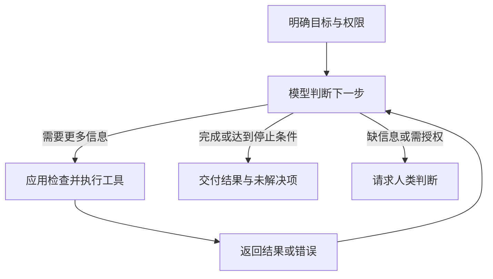

# Agent 与 Workflow：谁来决定下一步

> **TL;DR**：Workflow 预设流程；Agent 根据反馈动态决定后续步骤。

## 你能在这里学到

- Workflow 与 Agent 的区别与组合方式
- 为什么工具调用和 RAG 不等于 Agent
- 如何确定停止条件、预算与人工确认点

## 前置知识

- [工具调用](./tool-calling)
- [RAG 与知识库](./rag-and-knowledge-bases)

## 一、先看谁控制流程

“Agent”在不同产品中用法不一。本文采用 [Anthropic](https://www.anthropic.com/engineering/building-effective-agents) 与 [LangGraph](https://docs.langchain.com/oss/python/langgraph/workflows-agents) 的区分：

| 维度 | Workflow（工作流） | Agent（智能体） |
| --- | --- | --- |
| 下一步 | 程序预设步骤与分支 | 模型根据目标和反馈动态选择 |
| 典型任务 | 固定资料生成固定格式报告 | 逐步调查尚不清楚的问题 |
| 主要取舍 | 可预测，但流程变化需调整设计 | 灵活，但成本与错误更难预估 |

Workflow 可以包含模型判断、循环和人工审批，预设流程不等于每次输出相同。Agent 也受应用提供的工具与权限约束，并不意味着完全自主。

## 二、同一个助手，两种组织方式

继续使用**虚构的团队文档助手，以下不是已运行实验**。用户希望了解项目发布流程、检查当前任务，得到待确认的清单。

**Workflow 方案**：程序预设“检索发布文档 → 查询指定任务状态 → 按模板生成检查清单”。若缺任务编号，就进入预设的补充信息分支。适合输入和交付格式稳定的日常检查。

**Agent 方案**：用户问“这次发布还缺什么？”模型读文档后决定查询哪些任务；遇到“待验收”，继续查询验收记录；发现记录冲突，再请求人工判断。具体查询次数和顺序由反馈决定。

Agent 适合路径难以事先列全、但能检查中间结果的任务；若一份材料加一次总结就够，没有必要增加循环。

## 三、循环需要出口

[Anthropic 的机制说明](https://www.anthropic.com/engineering/building-effective-agents)强调环境反馈、人工检查点和停止条件。应用需要限制总耗时、费用与调用次数，并识别无进展的重复尝试。

本例可**假设**最多查询 5 次：材料齐全时交付清单；预算耗尽、无权限或来源冲突时，标明已知事实和待确认项并停止。这个数字只是设计示意，应通过实际任务评估调整。

清单是草稿，不代表任务已验收或发布获批。修改远程任务、发送通知或发布文档应受明确授权与确认机制约束，模型不能自行扩大任务目标。

## 四、它们与 RAG、工具是什么关系

**RAG 是检索资料辅助回答的方法，工具提供查询或操作能力，Workflow 与 Agent 决定如何组织步骤。** 团队助手可以在固定工作流中使用 RAG，也可以由 Agent 动态决定何时检索。

一个系统还能混合两者：整体采用固定审批流程，中间的一步交给 Agent 调查。关键是明确每一步由谁决定、完成标准是什么。

## 常见问题 FAQ

**工具越多、Agent 越多就越好吗？**

不一定。增加工具会增加选择负担，多 Agent 还需要分工、传递信息和汇总。只有实际评估证明这些开销换来了更好的结果，才值得增加复杂度。

## 参考

- [Anthropic · Building effective agents](https://www.anthropic.com/engineering/building-effective-agents)（采用概念区分与设计原则，不依赖文中的产品版本；访问于 2026-09-30）
- [LangGraph · Workflows and agents](https://docs.langchain.com/oss/python/langgraph/workflows-agents)（访问于 2026-09-30）

## 下一步

- 验证方案是否有效 → [如何评估 AI](./evaluating-ai)

## 如果你想

- 看外部动作如何执行 → [工具调用](./tool-calling)
- 深入研发任务的组织方式 → [AI Harness 工程](/ai-harness/)
