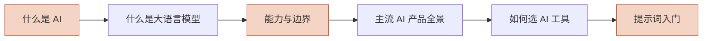
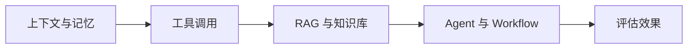

# AI 入门

> 从这里认识 AI，再理解一个 AI 应用怎样工作。基础路线约 30 分钟，应用路线约 25 分钟，可按需要分两次阅读。

## 谁应该读这一章

- **完全没接触过 AI** — 想搞清楚它是什么、能做什么、不能做什么
- **用过但没系统了解** — 想知道大模型为什么这么强、有哪些坑
- **想选工具的人** — 面对 ChatGPT / Claude / Gemini / 豆包无从下手，想要一张选型地图
- **想理解 AI 应用的人** — 想分清上下文、RAG、工具调用和 Agent 各解决什么问题

已掌握基础概念，可以直接读下方的[应用路线](#理解-ai-应用)；想研究训练和架构，则进入 [AI 核心技术](/ai-core/)。

## 基础阅读顺序

能力边界（图中橙色）是最值得仔细读的一页：**知道 AI 不行什么，比知道它能什么更重要**——大部分翻车都源于预期错位。

## 基础路线目录

| # | 页面 | 一句话 | 时长 |
| --- | --- | --- | --- |
| 1 | [什么是 AI](./what-is-ai) | 从符号 AI 到生成式 AI，一次快速历史散步 | 4 分钟 |
| 2 | [什么是大语言模型](./what-is-llm) | 非技术视角：模型是怎么练出来的、为什么这么强 | 5 分钟 |
| 3 | [能力与边界](./capabilities-and-limits) | 能做 / 不能做一张表——管理预期，避免翻车 | 6 分钟 |
| 4 | [主流 AI 产品全景](./ai-tools-landscape) | ChatGPT / Claude / Gemini / 豆包……一张地图 | 5 分钟 |
| 5 | [如何选择 AI 工具](./choosing-ai-tool) | 按场景选：对话 / 写作 / 编程 / 研究 / 企业 | 5 分钟 |
| 6 | [提示词入门](./prompting-basics) | 通用提示技巧，不绑定任何厂商 | 5 分钟 |

## 理解 AI 应用

这条路线用同一个**虚构的团队文档助手**串起概念：根据项目资料回答发布流程、查询任务状态、起草待确认的检查清单。它是理解机制的例子，不是已部署或实测的产品。

| 顺序 | 页面 | 读完应能回答 |
| --- | --- | --- |
| 1 | [Token、上下文与记忆](./tokens-context-memory) | 模型这次看到了什么？保存的信息会自动被使用吗？ |
| 2 | [工具调用](./tool-calling) | 是模型还是程序执行动作？结果如何回来？ |
| 3 | [RAG 与知识库](./rag-and-knowledge-bases) | 自己的资料如何进入答案？与微调有何区别？ |
| 4 | [Agent 与 Workflow](./agents-and-workflows) | 谁决定下一步？何时需要人工确认和停止？ |
| 5 | [如何判断 AI 应用是否有效](./evaluating-ai) | 怎样检查答案、证据和动作，而不是只看演示？ |

**阅读后的产出**：选一个自己的任务，画出“资料从哪里来 → 谁执行动作 → 如何确认完成”，再写下三个应通过的样例和一个应拒绝或停止的情况。

## 下一步

读完本章后：

- **想补齐应用概念** → 从 [Token、上下文与记忆](./tokens-context-memory) 开始
- **想知道底层原理** → [AI 核心技术](/ai-core/)
- **想在编程中落地** → [AI 工具](/ai-coding/)
- **想跟踪行业动态** → [AI 产品动向](/ai-trends/)

## 如果你想

- 深入了解某个厂商 → [国外厂商](/ai-trends/vendors/) / [国内厂商](/ai-trends/cn-vendors/)
- 直接开始用 Claude Code → [Claude Code 快速上手](/claude-code/getting-started/what-is-claude-code)
- 查术语中英对照 → [术语表](/contributing/glossary)
